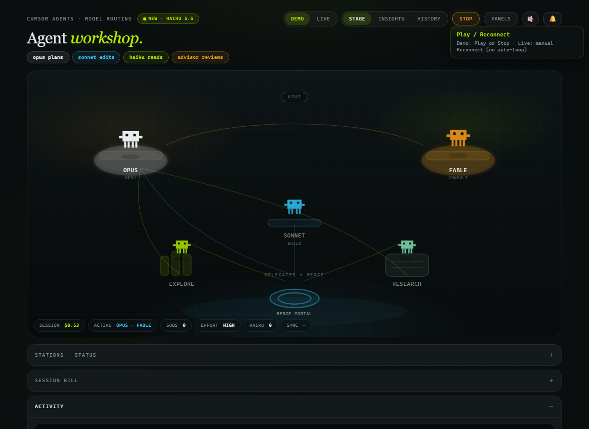

# Cursor Agents · Model Routing

[](https://github.com/thymeed/cursor-agents-model-routing/actions/workflows/ci.yml)
[](LICENSE)
[](CHANGELOG.md)

Desktop dashboard for visualizing how a Cursor Agents session routes work across Opus (parent), Fable (advisor), Worker (Sonnet), Explorer / Researcher (Haiku).



See [CHANGELOG.md](CHANGELOG.md) for release notes.

The first viewport is a soft **agent workshop**: five cute Claude-agent-style station figures (Opus desk, Fable consult, Sonnet build, Explore / Research shelves) — **Cursor Agents** branding, not Claude Code product UI — walk paths and carry code crates into a central **Merge portal**. On ask/delegate, a small **inbound route token** flies along the pulse path into the target station. Demo Play and Live SSE drive the stage; Session Bill, Activity, Insights, History/Replay, Session Log, and **Stations** live as **drawer sheets** under the stage. Header **Stage | Insights | History** switches which sheet owns the lower chrome (workshop stays visible). Station cards use **unique soft faces** per role (matching the stage cast), including distinct idle mouths (flat smile / deep grin / dash / open U / o — not one shared curve). HUD chips are the single status strip (session $, active role, subs, effort, haiku tokens). **History** Replay play/pause/scrub/speed drives the same workshop engine (crates/characters); leaving History stops transport and leaves the last replay frame until Demo/Live runs again. Estimates remain illustrative · not official usage. Optional cute Web Audio blips are **muted by default** — toggle 🔊/🔇 in the header (persisted in `localStorage`).

**Primary launch:** double-click repo-root **`AgentWorkshop.exe`** (produced by `npm run build` / `npm run pack` via `scripts/copy-exe.js` from `dist\`; gitignored `*.exe`), or run `npm start` while developing. Window title: **Cursor Agents · Model Routing**. The live bridge runs **in-process** inside Electron — no CMD popup, no separate `node.exe` console.

A second launch focuses the existing window (single-instance lock); it does not start another bridge on the same port.

## Install & start (development)

```bat
cd /d path\to\cursor-agents-model-routing
npm install
npm start
```

- Opens the Electron window only (`electron .`).
- Bridge listens on `http://127.0.0.1:3847/` in the same process.
- Optional port override: set `CURSOR_BRIDGE_PORT` before `npm start` (default `3847`).

```bat
set CURSOR_BRIDGE_PORT=3848
npm start
```

### Live project picker

In the window, **Live** mode shows a **project** dropdown fed by `~/.cursor/projects/*/agent-transcripts` (newest first by default). Choosing another project `POST`s `/api/select` (with `X-Cursor-Bridge`) and the SSE stream emits `reset` so the session view clears and resyncs.

## Build / run the Windows `.exe` (silent GUI)

```bat
npm run pack
```

Builds the **portable** single-file exe and copies it to repo-root **`AgentWorkshop.exe`** (via `scripts/copy-exe.js`). Double-click that root file — no install, no sibling DLLs.

Full portable + NSIS installer pass:

```bat
npm run build
```

| File                                          | Use                                       |
| --------------------------------------------- | ----------------------------------------- |
| `AgentWorkshop.exe` (repo root)               | Primary launch — portable GUI, no install |
| `dist\AgentWorkshop.exe`                      | Same portable artifact before/after copy  |
| `Cursor Agents Model Routing Setup x.x.x.exe` | Optional NSIS installer (`npm run build`) |

Packaged apps use the Windows GUI subsystem: **no console window** on launch. There is no `.cmd` wrapper.

Do **not** copy `dist\win-unpacked\*.exe` to the repo root alone — that naked Electron binary needs `ffmpeg.dll` beside it. Use `npm run pack:dir` only to inspect an unpacked tree locally.

### Local disk cleanup (safe — rebuildable)

Git already ignores `dist/`, `*.exe`, and `node_modules/`. Source of truth is GitHub + `npm install` / `npm run pack`. Safe to delete locally anytime:

- Entire **`dist\`** folder (unpacked trees, portable duplicates, NSIS setup, blockmaps)
- Stale root **`AgentWorkshop.exe`** / legacy `*Portable*.exe` (recreate with `npm run pack`)
- Electron/builder caches under `%LOCALAPPDATA%\electron*` / `%LOCALAPPDATA%\electron-builder*` if you are reclaiming a lot of space (next pack re-downloads)

Keep **`node_modules\`** unless you are ready for a full `npm ci` / `npm install` (large reinstall). Never delete `.git` or source files.

## Project layout

| Path                           | Role                                                                 |
| ------------------------------ | -------------------------------------------------------------------- |
| `model-routing-dashboard.html` | Markup shell (Demo + Live UI)                                        |
| `dashboard/styles.css`         | Dashboard styles                                                     |
| `dashboard/cards.css`          | Station card / avatar / ship-celebration styles                      |
| `dashboard/insights.css`       | Insights / History drawer styles                                     |
| `dashboard/tips.css`           | TipLayer floating tooltip styles                                     |
| `dashboard/alerts.css`         | Alert center bell / popover styles                                   |
| `dashboard/app.js`             | Demo playbook, Live SSE client, workshop stage, Live presence        |
| `dashboard/insights.js`        | Insights forecast, cost-ranked suggestions, History/Replay UI        |
| `dashboard/replay-stage.js`    | Replay transport → workshop stage                                    |
| `dashboard/cards.js`           | Station cards, avatars, daily stats, privacy meter, ship celebration |
| `dashboard/tips.js`            | Unified TipLayer (`data-tip` / `data-tip-detail`)                    |
| `dashboard/alerts.js`          | In-app alert center (SSE `alert` + `GET /api/alerts`)                |
| `live-bridge.js`               | Headless/Electron bridge (HTML + `/dashboard/*` + APIs)              |
| `electron/main.js`             | Desktop window; starts bridge in-process                             |
| `test/demo-smoke.test.js`      | Demo-mode Playwright smoke test                                      |
| `test/cards-smoke.test.js`     | Station cards / avatars / Live timing smoke                          |
| `test/insights-smoke.test.js`  | Insights / suggestions / jump-to-agent smoke                         |

## Demo mode (static HTML fallback)

No server required:

1. Open `model-routing-dashboard.html` in a browser (`file://`). Relative links load `dashboard/styles.css` and `dashboard/app.js`.
2. Leave **Demo** selected and click **Play** — watch the workshop narrative (asks → explore/research → worker edit → advisor → ship).
3. Click a character to filter Activity; click the Merge portal to open Activity; use **Panels** for Bill, Log & Insights sheets (stays on Stage); switch **Insights** / **History** for forecast or replay. On **History**, play/pause/scrub/speed drives the workshop stage; unmute with 🔊 for soft blips.

## Lint, format, test

```bat
npm install
npm run lint
npm run format:check
npm test
npm run build:check
```

Or `npm run ci` for the same sequence. `npm test` needs Playwright Chromium once: `npx playwright install chromium`.

## Headless bridge (optional)

For browser-only Live mode without Electron:

```bat
npm run bridge
```

or:

```bat
node live-bridge.js
```

Then open **http://127.0.0.1:3847/** and click **Live**.

The bridge listens on loopback only and rejects non-localhost `Host` / foreign `Origin` (including `Origin: null`; no `Access-Control-Allow-Origin: *`). Open the dashboard from the bridge URL or Electron — not from another website. Demo via `file://` does not need the bridge; clicking **Live** from `file://` points at the client default `http://127.0.0.1:3847/` (file pages cannot read `CURSOR_BRIDGE_PORT` / `--port`).

Options:

```bat
node live-bridge.js --port 3847
node live-bridge.js --dir "C:\Users\<you>\.cursor\projects\<project>\agent-transcripts"
```

`CURSOR_BRIDGE_PORT` / `--port` also apply here. `start-live.cmd` is a legacy headless helper only — **not** the primary desktop launch path.

### What Live mode wires

| Source                                              | Use                                                                         |
| --------------------------------------------------- | --------------------------------------------------------------------------- |
| `~/.cursor/projects/*/agent-transcripts/**/*.jsonl` | Projects listed in the picker; newest selected by default                   |
| `GET /api/projects`                                 | Project list + current selection                                            |
| `POST /api/select` + `X-Cursor-Bridge: 1`           | Switch transcripts folder + reset watch state (JSON `{id}`; Sec-Fetch-Site) |
| SSE `GET /api/stream`                               | Events + `reset` when the project changes; also `event: alert`              |
| `GET /api/alerts`                                   | Last ~50 in-memory alerts (`{ id, ts, name, status, agentId? }`)            |
| `GET /api/events`, `GET /api/status`                | Debug / backlog                                                             |
| `GET /api/history?since=&session=`                  | Persisted history events (JSONL-backed; localhost Host/Origin guards)       |
| `POST /api/history/clear` + `X-Cursor-Bridge: 1`    | Wipe local history (`{"ok":true}`)                                          |

Roles are inferred from `Task` / `CallDynamicTool` `subagent_type` and subagent prompt text (`advisor`, `worker`, `explore`→explorer, `researcher`). Unknown types map to parent/generic.

### Live presence

The Live UI tracks a single presence state for the header hint, stage banner, and empty copy:

| State           | What you see                                                                            |
| --------------- | --------------------------------------------------------------------------------------- |
| `file-origin`   | Coach: open Electron or `http://127.0.0.1:<port>/` (Live from `file://` is unsupported) |
| `connecting`    | Soft connecting banner                                                                  |
| `bridge-down`   | Persistent banner + **Reconnect** (manual; no auto-reconnect loop)                      |
| `no-projects`   | Coach when the picker has no Cursor projects                                            |
| `quiet-healthy` | Connected with no recent events — idle workshop, not an error                           |
| `streaming`     | Active traffic + project chip                                                           |

First time you enter Live, a dismissible coach sheet explains the project picker, what Live sees, and the estimate disclaimer (`localStorage` `ca.liveOnboard.v1`). Demo is never blocked.

### Insights, stations & jump-to-agent

The **Insights** sheet is a playful workshop panel: forecast, cost-ranked **Suggestions**, and soft TipLayer copy. Suggestions are ranked by estimated dollar savings (then name). Clicking a row (or an alert with a mappable agent) jumps to that station — select character, open Activity, brief card highlight. The **Stations** drawer holds the living agent cards (cute faces, daily stats, privacy meter). None of this changes Cursor’s live routing; it only navigates the dashboard.

### TipLayer & ship celebration

Chrome, stage stations, HUD chips, station cards, Insights, History/Replay, and the alert center share one **TipLayer** hover/focus tip (`data-tip` / `data-tip-detail`, ~300ms delay) — prefer that over bare `title=` on primary controls. Ship / merge plays a short portal celebration and marks avatars done (respects `prefers-reduced-motion`).

### History & desktop alerts

The bridge keeps a **local event log** (JSONL) under the OS app-data profile — not in the git repo:

| Platform | Default path                                                                |
| -------- | --------------------------------------------------------------------------- |
| Windows  | `%APPDATA%\cursor-agents-model-routing\event-log.jsonl`                     |
| macOS    | `~/Library/Application Support/cursor-agents-model-routing/event-log.jsonl` |
| Linux    | `~/.local/share/cursor-agents-model-routing/event-log.jsonl`                |

Overrides: `CURSOR_EVENT_LOG` (file) or `CURSOR_EVENT_LOG_DIR` (directory). Entries older than **30 days** are pruned when the bridge starts. Values that look like API keys, tokens, passwords, or bearer secrets are **redacted before write**.

History event contract (stable):

```json
{
  "ts": "2026-01-01T00:00:00.000Z",
  "sessionId": "string",
  "agentId": "string",
  "parentId": null,
  "name": "string",
  "model": "string",
  "type": "spawn",
  "inputTokens": 0,
  "outputTokens": 0,
  "files": []
}
```

`type` is one of `spawn` | `turn` | `done` | `error`.

When an agent **finishes**, **errors**, or **stalls** (no activity for ~2 minutes), the bridge:

1. Broadcasts SSE `event: alert` with `{ id, ts, name, status, agentId? }` and keeps the last ~50 for `GET /api/alerts`.
2. In Electron, also fires a desktop Notification (name + status only).

The in-app **alert center** (header bell) lists the same alerts — mark read, snooze, clear, click to jump when a role/agent is mappable. Alerts show **only agent name and status** — never prompt text or file paths. Backlog/SSE replay quiet gates skip spam the same way card timing does.

### Limits

- Near-real, not hook-level realtime (no Cursor hooks required for this slice).
- **SESSION BILL** is transcript-estimated tokens × published rates per 1M input/output: Opus $4/$20, Sonnet $2/$10, Haiku $0.10/$0.50, Fable $10/$50. Estimates · illustrative · not official Cursor invoices.
- **ACTIVITY** preview lists reads and edits from the transcript (path + short detail). It does not include full file contents.
- Only sees chats that write into the selected transcripts folder.
- Hooks / statusline / Cursor SDK are complementary paths; this slice uses transcripts on disk.
